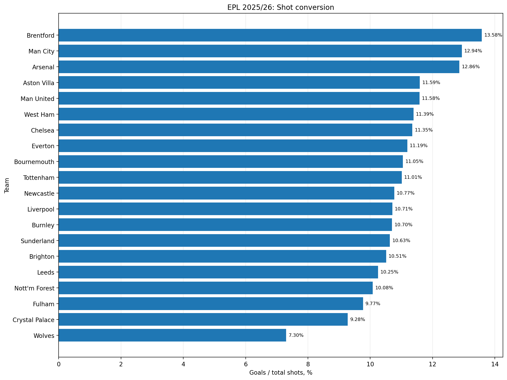
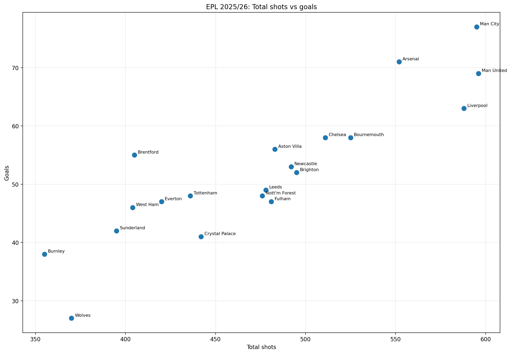

# Football Analytics: EPL 2025/26

Учебный проект по анализу статистики матчей Английской Премьер-лиги за сезон 2025/26 с использованием **PostgreSQL, SQL и Python**.

Проект отвечает на вопрос: **насколько количество ударов связано с результативностью команд и какая доля ударов заканчивается голами?**

## Аналитические вопросы

- Какие команды забили больше всего голов?
- У каких команд выше и ниже конверсия ударов в голы?
- Всегда ли большее количество ударов связано с большим количеством голов?
- Как отличаются команды по количеству ударов в створ и отношению голов к ударам в створ?

## Результаты

В текущем запуске обработано **380 матчей и 20 команд**. Для каждой команды рассчитаны:

- забитые голы;
- общее количество ударов;
- удары в створ;
- конверсия ударов в голы;
- доля ударов в створ от общего количества ударов;
- отношение забитых голов к ударам в створ.

### Основные наблюдения

- **Man City** забил больше всего голов — 77.
- **Man United** нанёс больше всего ударов — 596.
- **Brentford** показал самую высокую конверсию ударов в голы — 13,58%.
- **Wolves** показал самую низкую конверсию — 7,30%.
- У **Arsenal** самое высокое отношение голов к ударам в створ — 38,17%.

Это описательные результаты за один сезон, а не доказательство причинно-следственной связи. Конверсия не учитывает качество моментов; для более глубокого анализа пригодились бы данные xG.

### Графики

**Конверсия ударов в голы**



**Количество ударов и забитых голов**



Таблица с метриками: [results/team_analysis.csv](results/team_analysis.csv).

## Технологии

- **PostgreSQL** — хранение данных и SQL-агрегация.
- **Python 3.13** — автоматизация процесса.
- **pandas** — очистка данных и расчёт метрик.
- **SQLAlchemy + psycopg** — подключение к PostgreSQL.
- **Matplotlib** — графики.

## Запуск на Windows 10/11

Конвейер автоматизирует загрузку исходного CSV, очистку, создание таблиц, загрузку данных в PostgreSQL, SQL-анализ и сохранение результатов. Вручную скачивать CSV или запускать SQL-файлы не нужно.

### 1. Установить необходимое

Потребуются:

- Python 3.13;
- установленный и запущенный PostgreSQL;
- пользователь PostgreSQL с правом создавать базы данных;
- доступ к интернету для загрузки исходного CSV.

### 2. Клонировать репозиторий

Открой PowerShell и выполни:

```powershell
git clone https://github.com/liklife/football-analytics-epl.git
cd football-analytics-epl
```

Если репозиторий уже клонирован, перейди в его папку вместо повторного клонирования.

### 3. Установить зависимости

```powershell
python -m pip install -r requirements.txt
```

### 4. Запустить конвейер

```powershell
python scripts/run_pipeline.py
```

Скрипт запросит пароль пользователя PostgreSQL `postgres`. При вводе пароль не отображается — это нормальное поведение.

Скрипт использует отдельную базу данных **`football_analytics_demo`** и не должен изменять существующую базу `football_analytics`. Пользователь PostgreSQL должен иметь право создавать базы данных. Если PostgreSQL использует не стандартный адрес или порт, настройки подключения в скрипте потребуется изменить.

### 5. Найти результаты

После успешного выполнения:

- `data/raw/E0.csv` — исходный CSV-файл сезона 2025/26, включённый в репозиторий;
- `data/processed/E0_clear.csv` — очищенные данные;
- `results/team_analysis.csv` — таблица метрик команд;
- `results/shot_conversion.png` — график конверсии ударов;
- `results/shots_vs_goals.png` — график ударов и голов.

Если запуск завершился ошибкой, проверь, что служба PostgreSQL запущена, пароль верен, у пользователя есть право создавать базы данных и доступен сайт источника данных.

## Источник данных

[Football-Data.co.uk — статистика английских лиг](https://www.football-data.co.uk/englandm.php).

Используются дата матча, команды, голы, общее количество ударов и удары в створ. Исходный CSV-файл `data/raw/E0.csv` включён в репозиторий. Если файл отсутствует локально, скрипт пытается скачать его с Football-Data.co.uk.
## Ограничения

- Конверсия ударов не учитывает качество голевых моментов и xG.
- Удары, не попавшие в створ, могут включать заблокированные удары, а не только промахи.
- Анализ охватывает один сезон и не устанавливает причинно-следственные связи.
- Результаты зависят от полноты и корректности исходной статистики.

## Структура проекта

```text
data/
├── raw/
│   └── E0.csv              # исходные данные сезона 2025/26
└── processed/              # очищенные данные
scripts/
├── prepare_data.py         # подготовка данных
├── analyze_teams.py        # анализ команд
└── run_pipeline.py         # полный автоматический конвейер
sql/
├── analysis_queries.sql
└── setup_database.sql
results/
├── team_analysis.csv
├── shot_conversion.png
└── shots_vs_goals.png
docs/
└── notes.docx
```

## Статус проекта

Реализованы загрузка и подготовка данных, SQL-агрегация в PostgreSQL, расчёт показателей команд и визуализация. Автоматический конвейер проверен локальным запуском на 380 матчах. Следующий шаг — протестировать инструкцию в чистом окружении и расширить аналитическую часть.
